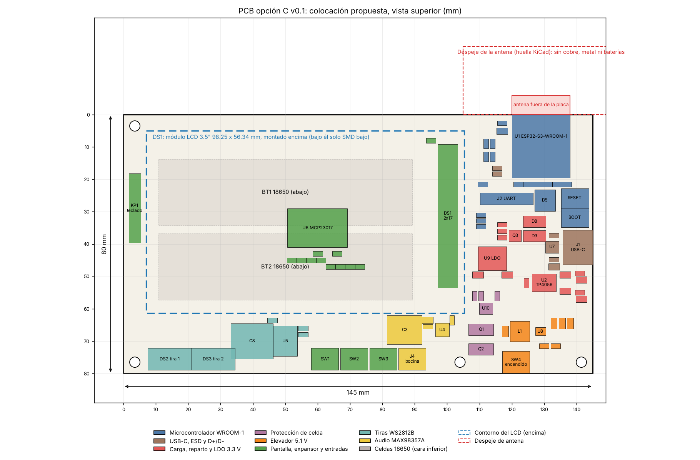

# Propuesta de PCB v0.1 para el esquemático C

Propuesta de placa para el esquemático v0.9 opción C (`Hw/esquematico_v1/opcion_c`). Cubre forma y tamaño, capas, apilado, colocación por bloques, reglas de ruteo, anchos de pista, huellas y reglas de fabricación para JLCPCB. Junto a este documento está un proyecto KiCad 7 de partida con las huellas colocadas y las redes asignadas, sin rutear. Fecha: 8 de noviembre de 2026.

Archivos en `Hw/pcb/`:

| Archivo | Qué es |
| --- | --- |
| `pcb_propuesta_v0.1.md` | Este documento |
| `colocacion_v0.1.png` | Diagrama de colocación, vista superior, en mm |
| `airsoft_tool_opcion_C.kicad_pcb` y `.kicad_pro` | PCB de partida: contorno, 4 capas, 96 huellas colocadas, redes, clases de red, plano GND en la capa 2 sin rellenar |
| `airsoft_tool_opcion_C.kicad_dru` | Reglas de diseño para JLCPCB |
| `airsoft_tool_opcion_C.net` | Netlist exportado del esquemático C con `kicad-cli` |
| `gen_pcb.py` | Genera la PCB desde el netlist (tabla de posiciones `PLACE`) |
| `dibujar_colocacion.py` | Genera el PNG desde la PCB |

Las huellas quedaron también en el esquemático. `gen_sch_c.py` tiene ahora una tabla `FOOTPRINT` y llena el campo Footprint de cada símbolo, así que "Update PCB from Schematic" funciona en KiCad. LS1 (la bocina) quedó marcada fuera de la placa.



## Forma y tamaño

Placa rectangular de 145 x 80 mm, 1.6 mm de espesor, con cuatro agujeros M3 (en (3.5, 3.5), (3.5, 76.5), (104, 76.5) y (141.5, 76.5), origen arriba a la izquierda).

El módulo de pantalla mide 98.25 x 56.34 mm según la ficha del MRB3503 en LCDWIKI. Va montado encima de la placa, conectado por un header hembra 2x17 (DS1) y sostenido por separadores. Ocupa el rectángulo de x = 7 a 105.25 mm, y = 5 a 61.34 mm. Debajo de él solo van piezas SMD bajas (la altura libre es la del header hembra, unos 8.5 mm, menos lo que sobresalgan los pines del módulo) y la cara inferior lleva las dos celdas.

A la derecha del LCD queda una columna de 40 mm con el módulo ESP32-S3-WROOM-1 arriba, el USB-C en el borde derecho y toda la potencia abajo. La franja inferior, de y = 62 a 80 mm, lleva los conectores de lo que vive en el gabinete (tiras, switches, bocina) y el audio.

El largo sale de sumar el LCD (98.25 mm), unos 15 mm de separación entre el marco metálico del LCD y la antena, los 18 mm del módulo y los conectores del borde derecho. Una placa más chica obliga a meter el módulo bajo el LCD, y el marco metálico de la retroiluminación le quitaría alcance a la antena.

No pude ver el plano mecánico del MRB3503 (el PDF de LCDWIKI es una imagen y el proxy de esta sesión no lo deja bajar), así que no sé dónde están sus agujeros de montaje ni en qué borde y a qué distancia está su conector 2x17. Supuse el conector sobre el borde corto derecho, del lado del micro, que es lo que más acorta el bus. Hay que medir el módulo de Roy antes de rutear y mover DS1 en `PLACE` si hace falta.

## Capas: cuatro

Recomiendo 4 capas. Razones:

- La guía de diseño de hardware del ESP32-S3 (`Hw/docs/esp32-s3_hardware_design_guidelines_en.pdf`, sección de layout general) recomienda cuatro capas con la capa 2 solo para GND. Dos capas son posibles, pero la propia guía aclara que no hay módulos oficiales de dos capas y que en ese caso la cara inferior debe tener el mínimo de pistas.
- Del módulo salen 33 señales más EN, repartidas en tres de sus lados: el bus 8080 de 16 bits más RS y WR, el SPI del touch, I2S, I2C, USB, UART, el dato de las tiras y el ADC. En dos capas buena parte tendría que cruzar por la cara inferior y partiría el plano de tierra justo bajo el módulo.
- El TPS61022 viene en VQFN de 2 x 2 mm y su lazo de potencia lleva picos de unos 3 A. TI pide un plano de tierra sólido inmediatamente debajo. En dos capas ese plano compite con las pistas.
- El par USB de 90 Ω sale con medidas razonables (0.29 mm de pista) porque el plano de referencia está a 0.21 mm. En dos capas de 1.6 mm haría falta un coplanar con tierra al lado.

Costo: JLCPCB cotiza 4 capas al subir los Gerber. No lo coticé para 145 x 80 mm; la lista de materiales v0.9 suponía 80 MXN por pieza en 2 capas y hay que actualizar ese renglón.

## Apilado

Apilado estándar de JLCPCB para 4 capas de 1.6 mm (JLC04161H-7628). La constante dieléctrica del prepreg 7628, 4.4, sale de la página de capacidades de JLCPCB. Los espesores los doy de memoria y hay que confirmarlos en la calculadora de impedancia de JLCPCB al hacer el pedido.

| Capa | Cobre | Uso |
| --- | --- | --- |
| L1 F.Cu | 1 oz (35 µm) | Todas las piezas SMD, bus de la pantalla, par USB, lazos de potencia, relleno de GND con vías de costura |
| Prepreg 7628 | ~0.21 mm, Dk 4.4 | |
| L2 In1.Cu | 0.5 oz | GND sólido en toda la placa. Sin pistas. |
| Núcleo | ~1.07 mm | |
| L3 In2.Cu | 0.5 oz | Islas de +3V3 y +5V, más señales lentas (I2C, I2S, SPI del touch, dato de tiras, teclado) |
| Prepreg 7628 | ~0.21 mm | |
| L4 B.Cu | 1 oz | Celdas BT1 y BT2 (THT), pistas anchas de batería (VBAT_CELDA y BAT_NEG), desborde del bus, resto relleno de GND |

Las capas internas son de 0.5 oz, así que ninguna corriente de batería va por ellas. El archivo `.kicad_dru` lo prohíbe para la clase POTENCIA.

La guía de Espressif pide no poner piezas en la cara inferior. BT1 y BT2 son la excepción. Quedan bajo el LCD, a más de 30 mm de la antena, y lejos del módulo.

## Colocación por bloques

Coordenadas en mm desde la esquina superior izquierda, vista superior. Están en la tabla `PLACE` de `gen_pcb.py`.

Microcontrolador (U1, x 120 a 138, y 0 a 19.5). El WROOM-1 va en el borde superior con la antena hacia afuera: los 6 mm de la antena quedan fuera de la placa, que es la posición que la guía de Espressif marca como la más recomendada. La huella de KiCad trae una zona de despeje de 48 x 21 mm sobre la antena que queda toda fuera de la placa. En el gabinete no debe haber metal, celdas ni la bocina a menos de 15 mm de la antena (también de la guía). C11 y C12 van junto al pin 2 (3V3), R22 y C10 junto a EN, los pull-ups y pull-downs de arranque en la fila de abajo del módulo. R27 y R28 de 22 Ω van junto a los pines 13 y 14 (USB), del lado del módulo, como pide la guía. J2 (UART) y los botones RESET y BOOT quedan bajo el módulo, accesibles.

USB-C (J1 en el borde derecho, y = 41). U7 (USBLC6-2SC6) pegado a J1, antes que cualquier otra cosa en D+ y D-. R25, R26 y C23 junto a J1. El par recorre unos 35 mm hasta R27 y R28.

Potencia (x 107 a 145, y 30 a 80). Ordenada en el sentido de la corriente. VBUS entra por J1, pasa a D8 y al cargador U2. Q3, D9 y el divisor de "USB presente" quedan entre J1 y el LDO U9, que va arriba, cerca del módulo, para que la pista de 3.3 V sea corta. La protección (U10, Q1, Q2) va abajo a la izquierda de la columna, del lado por donde llegan los cables de las celdas. El elevador (U8, L1, C17 a C20, R15 y R16) va abajo a la derecha, lejos de la antena y del bus. SW4 (encendido, en el gabinete) entra por un conector en el borde inferior.

Bajo el LCD. U6 (MCP23017) al centro con sus pull-ups y C9. KP1 (teclado) en el borde izquierdo, fuera del contorno del LCD. DS1 (header 2x17) a la derecha, junto al módulo.

Franja inferior (y 62 a 80). De izquierda a derecha: conectores de las tiras DS2 y DS3, C8, U5 con R5 y R8, conectores de SW1, SW2 y SW3, C3, el amplificador U4 con C13 y C4, y el conector de la bocina J4.

Celdas (cara inferior, bajo el LCD). BT1 de y 14 a 34 y BT2 de y 37 a 57, x 11 a 89. El polo positivo queda a la derecha (x = 86), cerca de la protección y del cargador. El negativo queda a la izquierda (x = 14) y hay que traerlo con una pista ancha por la cara inferior.

## Ruteo

### Bus de la pantalla (16 bits) y SPI del touch

LCD_D0 a LCD_D8 salen por el lado izquierdo del módulo (pines 4 a 12), LCD_D9 a LCD_D15 por abajo (17 a 24) y LCD_RS y LCD_WR por el lado derecho (38 y 39). DS1 está a unos 15 a 40 mm, según la línea. Ruteo en L1 sobre el GND de L2, desborde a L4, pistas de 0.15 mm con 0.15 mm de separación (clase BUS_LCD).

Con largos menores a 60 mm el bus no se comporta como línea de transmisión a las frecuencias del 8080 del ILI9486 (decenas de MHz como mucho), así que no hace falta igualar largos ni terminar. Sí conviene que LCD_WR, que es el reloj del bus, sea la más corta, que no corra paralela a otra señal más de 10 mm sin GND en medio, y dejar en la siguiente revisión del esquemático una resistencia en serie de 0 a 33 Ω junto al módulo en LCD_WR, por si aparecen rebotes. No la agregué al esquemático.

TOUCH_CLK, TOUCH_MOSI, TOUCH_MISO y TOUCH_CS van a menos de 2.5 MHz (límite del XPT2046), se pueden rutear en L3. Deben ir lejos de la antena y de U4.

Revisión obligatoria antes de fabricar: el orden de pines de DS1. La huella `PinSocket_2x17` numera los pines vistos desde arriba de la placa. Los pines del módulo se ven desde atrás, y al voltear el módulo sobre la placa las filas se invierten. Con el módulo en la mano hay que confirmar que el pin 1 del módulo cae en el pin 1 del header, o espejar la huella.

### USB

Par diferencial D+ y D- de 90 Ω ± 10 % (guía de Espressif, sección USB). Con el apilado de arriba sale pista de 0.29 mm con separación de 0.2 mm en L1. Lo calculé con la fórmula de microstrip de IPC-2141 (83 Ω con 0.15 mm de separación, 89 Ω con 0.2 mm y 0.30 mm de pista); hay que confirmarlo en la calculadora de JLCPCB. Sin vías, con GND continuo debajo en L2, rodeado de relleno de GND con vías cada 2 a 3 mm. Diferencia de largo menor a 0.5 mm. El USB del ESP32-S3 es de 12 Mbps, así que el tramo de 35 mm no es crítico, pero la regla está en el `.kicad_dru`.

### Planos de tierra

L2 es GND completo, sin pistas ni cortes. En L1 y L4 todo el espacio libre se rellena con GND y se cose a L2 con vías cada 5 mm en general y cada 2 a 3 mm a lo largo del borde superior junto al módulo y alrededor del par USB.

BAT_NEG no es GND. Es el negativo de las celdas antes de los MOSFET de protección y solo se une a GND a través de Q1 y Q2. Su pista va en L4 y L1 y no toca el plano de L2.

GND es un solo nodo, sin separar tierra analógica de digital. Las corrientes grandes (elevador, amplificador, tiras) tienen sus retornos en la esquina inferior derecha y en la franja inferior, lejos del módulo.

### Potencia: corrientes y anchos

Anchos calculados con IPC-2221 para 10 °C de subida. En cobre exterior de 1 oz salen 0.30 mm para 1 A, 0.78 mm para 2 A, 1.37 mm para 3 A y 2.76 mm para 5 A. En capas internas de 0.5 oz, 1 A ya pide 1.56 mm.

| Red | Corriente esperada | Ancho propuesto |
| --- | --- | --- |
| VBAT_CELDA, BAT_NEG, PROT_D | ~2.5 a 3 A de pico, la protección corta cerca de 5 A | Relleno de 3 mm o más en L1 y L4 en paralelo, 4 vías de 0.4 mm en cada cambio de capa |
| VSYS, VSYS_SW (y el conector de SW4) | igual | Igual. SW4 entra por JST XH de 3 A; si se quiere margen, JST VH |
| VBUS_USB | ~2 A (1 A de carga más el sistema) | 1.5 mm |
| BOOST_SW (nodo SW del elevador) | ~3 A de pico en L1 | Cobre corto y ancho de 2 mm, la menor área posible |
| +5V | 1.45 A de pico (tiras topadas a 600 mA y el amplificador) | 1 mm mínimo en L1; isla en L3 de 5 mm o más |
| +3V3 | ~0.5 A | 0.5 mm en L1; isla en L3 |
| SPK_P, SPK_N | ~0.9 A RMS a 3.2 W en 4 Ω | 0.6 mm, juntas y cortas |
| Señales | | 0.2 mm (bus 0.15 mm) |

La pista de BAT_NEG desde el extremo izquierdo de las celdas mide unos 95 mm. Con 5 mm de ancho en 1 oz tiene unos 9 mΩ, 28 mV de caída a 3 A. No afecta al disparo del DW01A, que mide en los MOSFET.

Clases de red ya cargadas en el `.kicad_pro`: POTENCIA 1.5 mm, 5V 1 mm, BOCINA 0.6 mm, 3V3_GND 0.5 mm, BUS_LCD 0.15 mm, USB 0.29 mm con 0.2 mm de separación.

### Lazo del elevador (TPS61022)

En un elevador el lazo de alta di/dt es el de salida: interruptor del lado alto, capacitor de salida y GND del integrado. Por eso:

- C18, el primer 22 µF de salida, va pegado a VOUT y GND de U8, en L1 y sin vías dentro del lazo. C19 y C20 inmediatamente después.
- C17 (entrada) va junto al lado de VIN de L1 y su GND al mismo punto que el GND de U8.
- L1 lo más cerca posible del pin SW; el nodo SW con poca área de cobre.
- R15 y R16 junto al pin FB. La realimentación se toma de C20 con una pista delgada que no pase bajo L1 ni junto al nodo SW.
- GND de U8, C17 y C18 a L2 con varias vías de 0.3 mm junto a los pads.
- En L3 y L4 no pasan señales bajo L1 ni bajo el nodo SW.

Es el ejemplo de layout de la sección Layout de la hoja de datos de TI. No lo verifiqué con la figura, que no tengo en `Hw/docs`; conviene bajar la hoja y compararlo antes de rutear.

### Desacoplos

Cada capacitor va pegado al pin que desacopla, con su GND por vía directa a L2.

| Pieza | Capacitores |
| --- | --- |
| U1 pin 2 (3V3) | C11 22 µF y C12 100 nF |
| U1 EN | C10 1 µF |
| U9 LDO | C21 entrada y C22 salida, 10 µF |
| U8 elevador | C17 entrada, C18 a C20 salida, 22 µF |
| U2 TP4056 | C15 en VCC y C16 en BAT, 10 µF |
| U10 DW01A | C14 100 nF con R31 |
| U4 amplificador | C13 10 µF y C4 100 nF en VDD; C3 470 µF cerca |
| U5 | C7 100 nF; C8 1000 µF en la entrada de 5 V de las tiras |
| U6 | C9 100 nF |
| J1 VBUS | C23 10 µF |
| VBAT_ADC | C2 100 nF junto a GPIO10 |

### Calor

U2 (TP4056) disipa hasta 1.3 W. Lleva la huella con vías térmicas bajo el pad expuesto y cobre de al menos 2 x 2 cm unido al pad en L1 y en L4. Queda lejos de las celdas. U4 (MAX98357A) también usa la huella con vías térmicas, a GND.

### ESD

U7 protege D+ y D- y va a menos de 5 mm de J1. VBUS lleva C23. El resto de los conectores (tiras, switches, teclado) no tiene protección ESD en el esquemático C. Las líneas que salen del gabinete son las más expuestas; si se agrega protección en otra revisión, el lugar es junto a cada conector.

## Huellas

Todas de las librerías estándar de KiCad 7.

| Referencia | Huella | Nota |
| --- | --- | --- |
| U1 | `RF_Module:ESP32-S3-WROOM-1` | Trae la zona de despeje de la antena |
| U2 | `Package_SO:SOIC-8-1EP_3.9x4.9mm_P1.27mm_EP2.41x3.3mm_ThermalVias` | ESOP-8 del TP4056; revisar tamaño del pad con el fabricante elegido |
| U4 | `Package_DFN_QFN:TQFN-16-1EP_3x3mm_P0.5mm_EP1.23x1.23mm_ThermalVias` | La que asigna el símbolo de KiCad al MAX98357A |
| U5 | `Package_SO:SOIC-14_3.9x8.7mm_P1.27mm` | Cambio: SN74AHCT125D en lugar del DIP-14 |
| U6 | `Package_SO:SOIC-28W_7.5x17.9mm_P1.27mm` | Cambio: MCP23017-E/SO en lugar del DIP-28 con zócalo; el DIP no cabe bajo el LCD |
| U7, U10 | `Package_TO_SOT_SMD:SOT-23-6` | |
| U8 | `Package_DFN_QFN:Texas_RWU0007A_VQFN-7_2x2mm_P0.5mm` | |
| U9 | `Package_TO_SOT_SMD:SOT-223-3_TabPin2` | Orden de pines sin verificar (ver README de la opción C) |
| Q1, Q2 | `Package_SO:TSSOP-8_4.4x3mm_P0.65mm` | |
| Q3 | `Package_TO_SOT_SMD:SOT-23` | |
| D5 | `LED_THT:LED_D5.0mm` | |
| D6, D7 | `LED_SMD:LED_0805_2012Metric` | |
| D8, D9 | `Diode_SMD:D_SMA` | |
| L1 | `Inductor_SMD:L_Coilcraft_XAL5030-XXX` | Huella de 5 x 5 mm. La pieza debe ser de 1 µH con Isat de 8 A o más; si se compra otra, cambiar la huella |
| J1 | `Connector_USB:USB_C_Receptacle_HRO_TYPE-C-31-M-12` | HRO TYPE-C-31-M-12, está en el catálogo de JLCPCB |
| J2 | `PinHeader_1x06_P2.54mm_Vertical` | |
| DS1 | `PinSocket_2x17_P2.54mm_Vertical` | Header hembra para el LCD; revisar pin 1 (ver ruteo) |
| KP1 | `PinHeader_1x08_P2.54mm_Vertical` | La cola del teclado de membrana se conecta aquí |
| DS2, DS3 | `JST_XH_B4B-XH-A_1x04_P2.50mm_Vertical` | 4 hilos: +5V, DIN, GND y DOUT. DS2 necesita el cuarto hilo porque su DOUT regresa a la placa por R8 |
| SW1 a SW4, J4 | `JST_XH_B2B-XH-A_1x02_P2.50mm_Vertical` | Los switches, el botón de acción, el encendido y la bocina van en el gabinete |
| SW5, SW6 | `Button_Switch_SMD:SW_SPST_TL3342` | RESET y BOOT |
| BT1, BT2 | `Battery:BatteryHolder_MPD_BH-18650-PC2` | Cambio: dos portapilas sencillos THT en la cara inferior en lugar de uno doble; revisar en la hoja de MPD cuál pad es el positivo |
| C3 | `Capacitor_SMD:CP_Elec_8x10` | |
| C8 | `Capacitor_SMD:CP_Elec_10x10` | |
| Resistencias | `R_0603_1608Metric` | |
| Capacitores de 100 nF y 1 µF | `C_0603_1608Metric` | |
| Capacitores de 10 y 22 µF | `C_0805_2012Metric` | |

Estos cambios contra la lista de materiales v0.9 (MCP23017 y 74AHCT125 en SMD, dos portapilas sencillos, conectores JST XH, nada de zócalo DIP) no están todavía en `lista_materiales_v0.9_opcionC.xlsx`.

## Reglas para JLCPCB

Valores de https://jlcpcb.com/capabilities/pcb-capabilities, consultada el 8 de noviembre de 2026, y lo que propongo usar, con margen.

| Parámetro | Mínimo de JLCPCB (multicapa, 1 oz) | Propuesto |
| --- | --- | --- |
| Pista / separación | 0.09 / 0.09 mm | 0.127 / 0.127 mm mínimo; 0.15 en el bus y 0.2 en general |
| Broca de vía | 0.15 mm (0.2 mm preferido) | 0.3 mm en general, 0.2 mm solo en las vías térmicas que traen las huellas |
| Diámetro de vía | 0.25 mm | 0.6 mm (0.45 mm mínimo en reglas) |
| Anillo de vía | 0.15 mm absoluto, 0.2 recomendado | 0.15 mm (0.6 / 0.3) |
| Cobre al borde | 0.2 mm en borde fresado | 0.3 mm |
| Agujero a agujero | 0.45 mm | 0.5 mm |
| Dieléctrico del prepreg 7628 | Dk 4.4 | Para el cálculo de 90 Ω |

Las vías de 0.3/0.6 mm no tienen cargo extra en JLCPCB. Las vías térmicas del WROOM-1 en la huella de KiCad son de 0.2 mm, dentro de lo que acepta JLCPCB para multicapa. Si se pide ensamble SMD (necesario para U8 y U4, que no se sueldan con cautín), conviene elegir piezas de su catálogo y revisar su regla de separación entre piezas.

## Qué está verificado y qué no

Verificado en esta sesión:

- El netlist sale del esquemático C con `kicad-cli sch export netlist` (93 símbolos, 92 con huella, 104 redes contando los pines sin conectar) y cada pad numerado de la PCB tiene la red del pin con el mismo número.
- El DRC de KiCad sobre la PCB de partida no da choques de huellas, ni violaciones de separación, ni de cobre al borde. Quedan 271 conexiones sin rutear, avisos de serigrafía encimada (normal antes de acomodar textos) y 96 avisos de "librería" porque el entorno donde se generó no tiene tabla de librerías de huellas; en una instalación normal de KiCad desaparecen.

Sin verificar:

- Ubicación del conector 2x17 y de los agujeros del LCD, y el orden del pin 1 del header (sección de ruteo).
- La correspondencia entre la numeración de pines de los símbolos y la de las huellas en las piezas cuyo patillaje ya estaba sin verificar en el esquemático C: DW01A, FS8205A, AP7361C-33E, USBLC6-2SC6, TP4056 (pad 9 = pad expuesto).
- La polaridad de los pads del portapilas MPD BH-18650-PC2, el tamaño real de la pieza L1 que se compre y el patillaje del conector USB-C si no es el HRO.
- Espesores del apilado y el cálculo de 90 Ω (fórmula aproximada; usar la calculadora de JLCPCB).
- El layout del TPS61022 contra la figura de TI.
- El costo de la placa de 4 capas.
- La PCB no tiene ruteo, el plano de L2 no está rellenado (en KiCad se rellena con la tecla B) y faltan los rellenos de GND de L1 y L4 y las islas de L3.

## Cómo regenerar

Se necesita KiCad 7 con sus librerías (`apt-get update` y luego `apt-get install kicad kicad-symbols kicad-footprints`) y matplotlib. En Ubuntu 24.04, pcbnew y matplotlib funcionan con `/usr/bin/python3.12`.

```
cd Hw/esquematico_v1/opcion_c
python3 gen_sch_c.py airsoft_tool_opcion_C.kicad_sch /tmp/bom.csv
cd ../../pcb
kicad-cli sch export netlist --format kicadsexpr -o airsoft_tool_opcion_C.net ../esquematico_v1/opcion_c/airsoft_tool_opcion_C.kicad_sch
python3.12 gen_pcb.py airsoft_tool_opcion_C.net airsoft_tool_opcion_C.kicad_pcb
python3.12 dibujar_colocacion.py airsoft_tool_opcion_C.kicad_pcb colocacion_v0.1.png
```

`gen_pcb.py` sobrescribe la PCB. En cuanto se empiece a rutear a mano en KiCad hay que dejar de correrlo y pasar los cambios del esquemático con "Update PCB from Schematic". Como `gen_sch_c.py` crea UUID nuevos en cada corrida, en ese diálogo hay que marcar la opción de volver a ligar las huellas por referencia.

## Pasos siguientes

1. Medir el LCD de Roy: posición del conector 2x17, agujeros de montaje y altura; confirmar el pin 1 al voltearlo.
2. Revisar los patillajes pendientes con las hojas de datos.
3. Elegir piezas del catálogo de JLCPCB si se va a pedir ensamble, y ajustar huellas.
4. Rutear en este orden: lazo del elevador, protección y celdas, USB, alimentación del módulo, bus de la pantalla, el resto.
5. Actualizar la lista de materiales con los cambios de la tabla de huellas y el costo de 4 capas.
