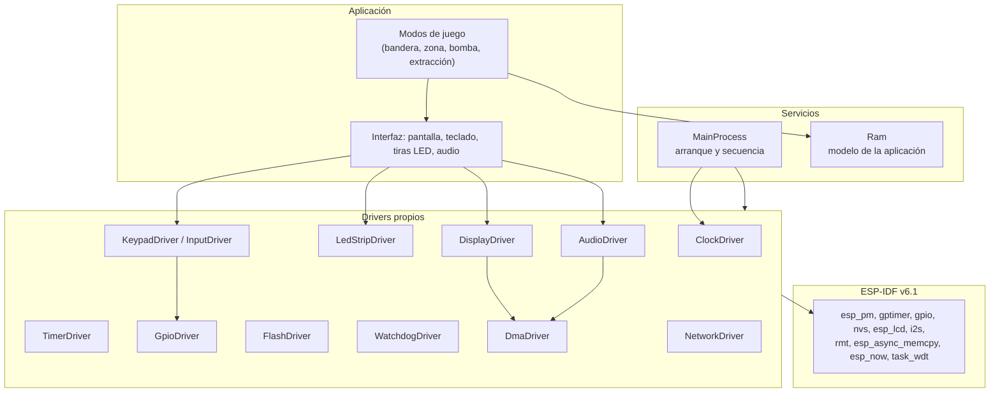
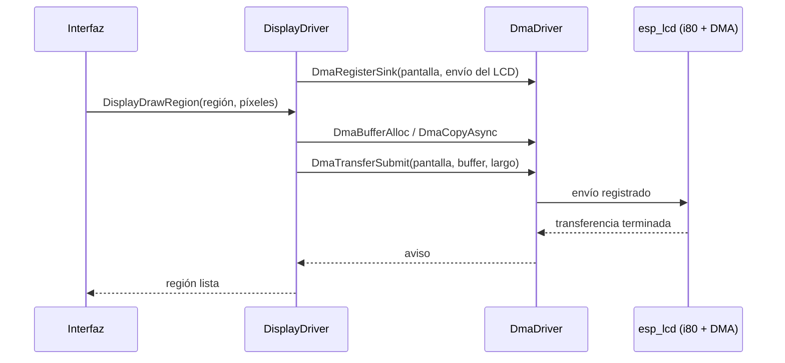
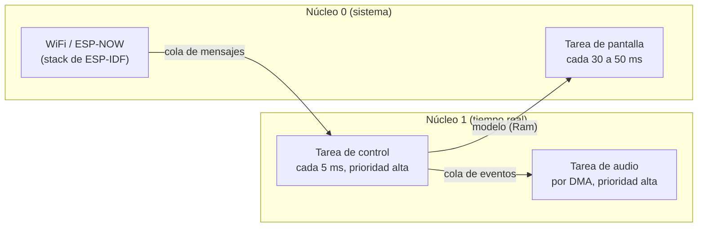

# Arquitectura del firmware

Documento de diseño (tarea 1). Define las reglas de encapsulamiento, la organización en capas, el catálogo de drivers, el reparto de tareas y núcleos, la memoria y el plan de PRs para la tarea 2 (un driver por PR). El código actual está en [`README.md`](README.md); aquí se describe el **objetivo** y cuánto le falta al código.

## 1. Principios

1. **Quien consume no conoce el mecanismo.** Un módulo de aplicación llama a una función del driver y recibe un resultado; no ve handles, tareas, notificaciones, pines ni registros.
2. **Cada periférico tiene un solo dueño.** El driver posee sus pines, su estado y sus recursos de ESP-IDF.
3. **Las dependencias van hacia abajo.** La aplicación usa drivers, los drivers usan ESP-IDF. Un driver nunca usa a la aplicación.
4. **El driver informa, quien llama decide.** Los drivers devuelven `esp_err_t` y escriben el error en el log; el módulo que los llama decide si es fatal (`ESP_ERROR_CHECK`) o recuperable.

## 2. Reglas

| Regla | Enunciado |
| --- | --- |
| R1 | Un driver no incluye `Ram.h`. El estado que comparte con el resto se expone con funciones del driver. |
| R2 | Los headers de los drivers no exponen tipos de FreeRTOS ni handles de ESP-IDF; solo tipos simples, tipos de `GlobalDefine.h` y `esp_err_t`. |
| R3 | El consumidor usa funciones de alto nivel (por ejemplo `TimerConsumeMainTick()`). La bandera, la notificación y la ISR son internas del driver. |
| R4 | Cada periférico posee sus pines. `MainProcess` solo llama a la inicialización de cada driver y no conoce el pinout. |
| R5 | Hay una sola secuencia de arranque, en `MainProcess`: reloj, periféricos, timer. `main.c` llama a `InitMainProcess()` y ejecuta el ciclo. |
| R6 | `Ram` guarda solo el modelo de la aplicación (equipo, armado, tecla, estado del juego). Cada variable tiene un único dueño de escritura. |
| R7 | Las rutinas de interrupción y los datos que tocan viven dentro del driver; se marcan `IRAM_ATTR` y no llaman funciones bloqueantes. |

Se mantienen las reglas de formato del [`README.md`](README.md): constantes `C_*` en `GlobalDefine.h`, uniones `[tamaño][Nombre]` con bits `bf_*`, comparaciones explícitas y headers de archivo y de función.

## 3. Capas objetivo

Reglas de la figura: una flecha hacia abajo es "usa". Ningún driver apunta hacia `Ram` ni hacia la aplicación.

## 4. Catálogo de drivers

| Driver | Hardware | Backend en ESP-IDF | Estado |
| --- | --- | --- | --- |
| `ClockDriver` | Reloj del CPU a 240 MHz | `esp_pm`, `esp_clk_tree` | Hecho (esta rama) |
| `GpioDriver` | Pines de entrada y salida | `esp_driver_gpio` | Hecho |
| `TimerDriver` | Interrupción periódica de 5 ms | `esp_driver_gptimer` | Hecho; requiere refactor (R1 a R3) |
| `FlashDriver` | Configuración y estadísticas en flash | `nvs_flash` / particiones | Pendiente |
| `WatchdogDriver` | Watchdog de tareas y de interrupciones | `esp_task_wdt` | Pendiente |
| `DmaDriver` | Buffers aptos para DMA, copia asíncrona y cola de transferencias | `heap_caps`, `esp_async_memcpy` | Pendiente |
| `LedStripDriver` | Dos tiras WS2812B (GPIO 3 y 46) | `esp_driver_rmt` | Pendiente |
| `DisplayDriver` | TFT 480x320, bus paralelo de 8 bits | `esp_lcd` (i80) | Pendiente; usa `DmaDriver` |
| `AudioDriver` | MAX98357A por I2S | `esp_driver_i2s` | Pendiente; usa `DmaDriver` |
| `KeypadDriver` / `InputDriver` | Teclado 4x4, switches y botón | `GpioDriver` | Pendiente |
| `AdcDriver` | Voltaje de batería (GPIO 10) | `esp_adc` | Pendiente |
| `NetworkDriver` | Enlace entre dispositivos | `esp_now` | Diseño reservado; no se implementa aún |

## 5. Contrato de `DmaDriver`

El DMA tiene su propio archivo y los demás módulos solo lo consumen.

Límite de ESP-IDF v6.1: los canales y descriptores de DMA del LCD paralelo y del I2S los crean los propios drivers de ESP-IDF (`esp_lcd`, `i2s`); la API de bajo nivel (`esp_private/gdma.h`) es privada y no se usa. `DmaDriver` encapsula lo que sí es público:

- **Buffers aptos para DMA:** reserva con las capacidades y la alineación correctas (`MALLOC_CAP_DMA`, interna o PSRAM) y sincroniza la caché cuando hace falta.
- **Copia asíncrona memoria a memoria:** `esp_async_memcpy`, con DMA (por ejemplo del framebuffer en PSRAM a un buffer interno).
- **Cola de transferencias:** serializa los envíos hacia las salidas que registran `DisplayDriver` y `AudioDriver`.

Funciones públicas previstas (los nombres se fijan en el PR del driver):

| Función | Qué hace |
| --- | --- |
| `DmaInit()` | Instala la copia asíncrona y crea la cola. |
| `DmaBufferAlloc(tamaño, ubicación, &buffer)` / `DmaBufferFree(buffer)` | Buffer apto para DMA. |
| `DmaCopyAsync(destino, origen, largo, aviso)` | Copia por DMA con aviso al terminar. |
| `DmaRegisterSink(id, función de envío)` | Un driver de periférico registra cómo enviar datos. |
| `DmaTransferSubmit(id, buffer, largo, aviso)` | El consumidor entrega el buffer; `DmaDriver` lo encola y avisa al terminar. |

## 6. Contrato objetivo de `TimerDriver`

Hoy el consumidor pasa un `TaskHandle_t`, espera con `ulTaskNotifyTake`, lee y apaga una bandera de `Ram`. El objetivo es que el consumidor solo llame:

| Función | Qué hace |
| --- | --- |
| `TimerInit()` / `TimerStart()` | Configura y arranca el periodo de 5 ms. |
| `TimerWaitMainTick()` | Bloquea hasta el siguiente periodo (la espera es interna). |
| `TimerGetSystemTickMs()` | Milisegundos desde el arranque. |
| `TimerGetOverrunCount()` | Periodos que el ciclo no alcanzó a atender. |

La bandera `bf_5MsMainLoopFlag`, la notificación y la ISR pasan a ser privadas del driver. Cuando el ciclo principal se mueva a su propia tarea, esa tarea es la única que llama a `TimerWaitMainTick()`.

## 7. Tareas, núcleos y prioridades

| Tarea | Núcleo | Prioridad | Activación | Función |
| --- | --- | --- | --- | --- |
| Control | 1 | Alta | `TimerWaitMainTick()` cada 5 ms | Teclado, switches, máquina de estados, tiras LED. |
| Audio | 1 | Alta | Espera del I2S (DMA) | Genera y envía tonos. |
| Pantalla | 0 | Media | Cada 30 a 50 ms | Redibuja solo las regiones que cambiaron. |
| Red | 0 | Del sistema | Eventos de ESP-NOW | Envía y recibe mensajes de juego. |

Reglas de comunicación: las tareas no comparten variables modificables entre sí; se hablan por colas, grupos de eventos o notificaciones. El modelo (`Ram`) tiene un solo escritor, la tarea de control, y las demás lo leen.

Cambios de configuración que implica (se hacen en el PR que los necesite, no en este):
- `CONFIG_FREERTOS_HZ=1000` (hoy 100, tick de 10 ms).
- Pila propia en cada tarea; la de `app_main` (3.5 KB) es corta.
- La ISR del timer se asigna al núcleo desde el que se llama `gptimer_enable`; debe configurarse desde la tarea de control, en el núcleo 1.
- Evaluar `CONFIG_GPTIMER_ISR_IRAM_SAFE` si la ISR debe seguir viva durante escrituras en flash.

## 8. Memoria y particiones

- **RAM interna:** unos 284 KB libres. Un cuadro completo de 480x320 en RGB565 son 307,200 B y no cabe; el framebuffer iría en la PSRAM (8 MB) o se dibuja por regiones (cuadrante de 76,800 B, etiqueta de unos 9,600 B).
- **Flash:** la tabla de particiones por defecto da 1 MB a la app. Con ESP-NOW y gráficos conviene una tabla propia que aproveche los 16 MB. Propuesta a validar en el PR de `FlashDriver`:

| Partición | Tamaño propuesto | Uso |
| --- | --- | --- |
| `nvs` | 24 KB | Configuración y estadísticas |
| `otadata` | 8 KB | Control de actualización |
| `phy_init` | 4 KB | Calibración de radio |
| `ota_0` / `ota_1` | 3 MB cada una | Firmware y actualización OTA |
| `storage` | 4 MB | Sonidos y recursos gráficos |
| (libre) | resto | Reserva |

## 9. Red entre dispositivos

Se deja el diseño preparado sin implementar. El enlace sería **ESP-NOW** (directo entre ESP32, sin router).
- La lógica de cada modo de juego no depende del transporte: recibe y envía mensajes de juego por una cola.
- Formato de mensaje por juego: zona capturada, puntaje, sincronía de reloj.
- El stack de radio vive en el núcleo 0 y la lógica de juego en el 1.
- El consumo con radio encendida ya está incluido en la estimación de autonomía de [`../Hw/esquematico_v1/README.md`](../Hw/esquematico_v1/README.md).

## 10. Estado actual frente al objetivo

| Hallazgo | Regla | Dónde | PR que lo corrige |
| --- | --- | --- | --- |
| La ISR escribe `gSystemTickMs`, `gTickOverrunCount` y `u8MainFlag` de `Ram` | R1 | `TimerDriver.c` | Refactor de encapsulamiento |
| `ConfigPeriodicTimer` recibe un `TaskHandle_t` y el header incluye FreeRTOS | R2 | `TimerDriver.h` | Refactor de encapsulamiento |
| `main.c` espera la notificación y apaga la bandera | R3 | `main.c` | Refactor de encapsulamiento |
| El timer se configura y arranca en `main.c`, el resto en `MainProcess` | R5 | `main.c`, `MainProcess.c` | Refactor de encapsulamiento |
| `InitSimpleGpioPorts` conoce el pinout de teclado, switches, botón y tiras | R4 | `MainProcess.c` | Un driver por periférico |
| Las variables de `Ram` son escribibles desde cualquier módulo | R6 | `Ram.h` | Refactor de encapsulamiento |
| El reloj estaba dentro de `MainProcess` con el nombre `TimerInitialization` | R4 | `MainProcess.c` | Hecho: `ClockDriver` |

## 11. Plan de la tarea 2: un driver por PR

Cada PR parte de `develop` actualizado, lleva su propia branch y actualiza `README.md`, `Warnings.md` y `MemoryUsage.md`.

| Orden | PR | Contenido |
| --- | --- | --- |
| 0 | Refactor de encapsulamiento | `TimerDriver` según el punto 6, secuencia de arranque única, `Ram` con un dueño por variable. |
| 1 | `FlashDriver` | Escritura en flash (NVS) y tabla de particiones propia. |
| 2 | `WatchdogDriver` | Watchdog de tareas y de interrupciones. |
| 3 | `DmaDriver` | Buffers aptos para DMA, copia asíncrona y cola, según el punto 5. |
| 4 | `LedStripDriver` | Tiras WS2812B por RMT (ver decisiones abiertas). |
| 5 | `DisplayDriver` | TFT por i80 con `DmaDriver`, dibujo por regiones. |
| 6 | `AudioDriver` | Tonos por I2S con `DmaDriver`. |
| 7 | `KeypadDriver` / `InputDriver` | Teclado 4x4, switches y botón con antirrebote. |
| 8 | `AdcDriver` | Voltaje de batería. |

## 12. Decisiones abiertas

- **PWM:** las tiras son WS2812B (un pin de datos por tira), así que su driver es RMT, no PWM. Un `PwmDriver` solo haría falta para otro uso (por ejemplo atenuar la retroiluminación de la pantalla, que hoy va fija a 5 V). Pendiente decidir si se mantiene en el plan.
- **Orden del PR 0:** se propone hacer el refactor antes de agregar drivers nuevos. Confirmar.
- **Tabla de particiones:** los tamaños del punto 8 son una propuesta, no están medidos.
- **Licencia del proyecto:** sigue sin definirse y aparece como "Por definir" en los headers.
