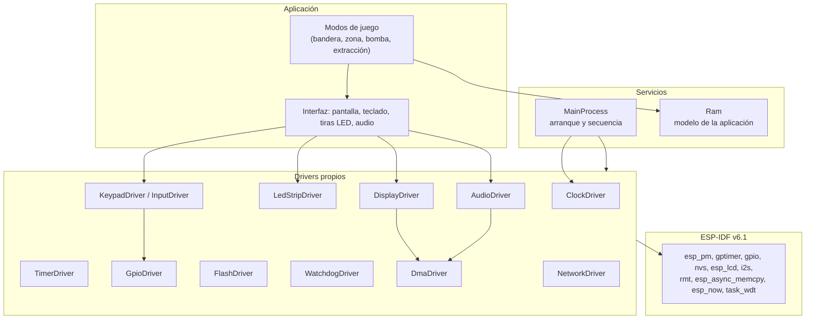
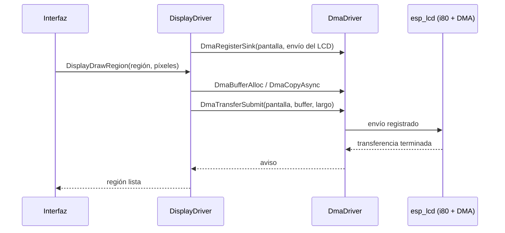
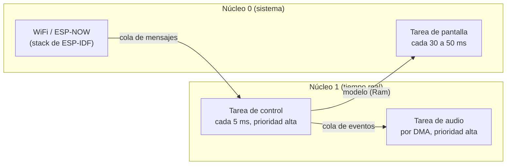
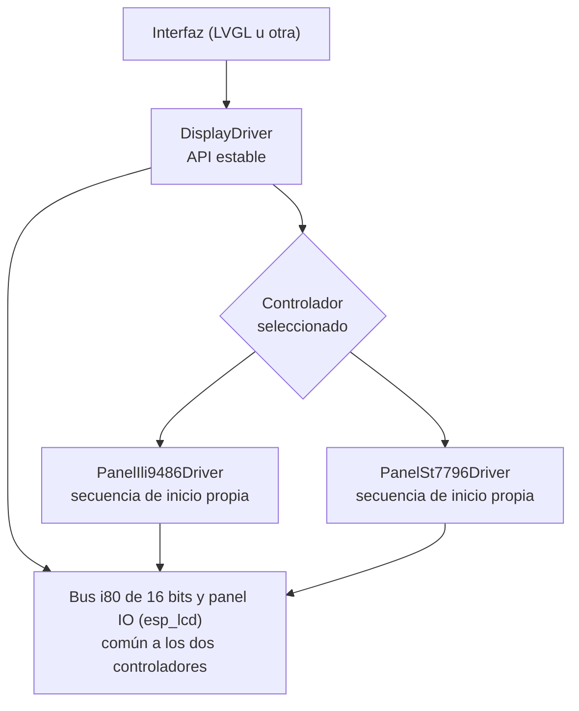

# Arquitectura del firmware

Documento de diseño (tarea 1). Define las reglas de encapsulamiento, la organización en capas, el catálogo de drivers, el reparto de tareas y núcleos, la memoria y el plan de PRs para la tarea 2 (un driver por PR). El código actual está en [`README.md`](README.md); aquí se describe el **objetivo** y cuánto le falta al código.

## 1. Principios

1. **Quien consume no conoce el mecanismo.** Un módulo de aplicación llama a una función del driver y recibe un resultado; no ve handles, tareas, notificaciones, pines ni registros.
2. **Cada periférico tiene un solo dueño.** El driver posee sus pines, su estado y sus recursos de ESP-IDF.
3. **Las dependencias van hacia abajo.** La aplicación usa drivers, los drivers usan ESP-IDF. Un driver nunca usa a la aplicación.
4. **El driver informa, quien llama decide.** Los drivers devuelven `esp_err_t` y escriben el error en el log; el módulo que los llama decide si es fatal (`ESP_ERROR_CHECK`) o recuperable.

## 2. Reglas

| Regla | Enunciado |
| --- | --- |
| R1 | Un driver puede incluir `Ram.h` solo para usar constantes y tipos (`C_*`, uniones); no lee ni escribe las variables de `Ram`. Lo hace cumplir el compilador: `Ram.h` solo declara las variables globales si el archivo define `C_RAM_EXPOSE_GLOBALS` antes de incluirlo, y los drivers no lo definen. El estado que un driver comparte con el resto se expone con funciones del driver. |
| R2 | Los headers de los drivers no exponen tipos de FreeRTOS ni handles de ESP-IDF; solo tipos simples, tipos de `GlobalDefine.h` y `esp_err_t`. |
| R3 | El consumidor usa funciones de alto nivel (por ejemplo `TimerConsumeMainTick()`). La bandera, la notificación y la ISR son internas del driver. |
| R4 | Cada periférico posee sus pines. `MainProcess` solo llama a la inicialización de cada driver y no conoce el pinout. |
| R5 | Hay una sola secuencia de arranque, en `MainProcess`: reloj, periféricos, timer. `main.c` llama a `InitMainProcess()` y ejecuta el ciclo. |
| R6 | `Ram` guarda solo el modelo de la aplicación (equipo, armado, tecla, estado del juego). Cada variable tiene un único dueño de escritura. |
| R7 | Las rutinas de interrupción y los datos que tocan viven dentro del driver; se marcan `IRAM_ATTR` y no llaman funciones bloqueantes. |
| R8 | Ningún archivo incluye `GlobalDefine.h`: se incluye solo desde `Ram.h`, y el resto de los archivos incluye `Ram.h` como header común de constantes y tipos. Las variables globales solo se ven con `C_RAM_EXPOSE_GLOBALS` (hoy lo definen solo `main.c` y `Ram.c`). |

Se mantienen las reglas de formato del [`README.md`](README.md): constantes `C_*` en `GlobalDefine.h`, uniones `[tamaño][Nombre]` con bits `bf_*`, comparaciones explícitas y headers de archivo y de función.

## 3. Capas objetivo

Reglas de la figura: una flecha hacia abajo es "usa". Ningún driver lee ni escribe variables de `Ram` ni usa la aplicación (puede incluir `Ram.h` solo para constantes y tipos, R1 y R8).

## 4. Catálogo de drivers

| Driver | Hardware | Backend en ESP-IDF | Estado |
| --- | --- | --- | --- |
| `ClockDriver` | Reloj del CPU a 240 MHz | `esp_pm`, `esp_clk_tree` | Hecho (esta rama) |
| `GpioDriver` | Pines de entrada y salida | `esp_driver_gpio` | Hecho |
| `TimerDriver` | Interrupción periódica de 5 ms | `esp_driver_gptimer` | Hecho; cumple R1 a R3 |
| `FlashDriver` | Configuración y estadísticas en flash | `nvs_flash` / particiones | Hecho |
| `HeartbeatDriver` | LED de verificación del ciclo principal (GPIO43, ciclo de 1 s) | `GpioDriver` | Hecho |
| `WatchdogDriver` | Watchdog de tareas y de interrupciones | `esp_task_wdt` | Pendiente |
| `DmaDriver` | Buffers aptos para DMA, copia asíncrona y cola de transferencias | `heap_caps`, `esp_async_memcpy` | Pendiente |
| `LedStripDriver` | Dos tiras WS2812B (GPIO 3 y 46) | `esp_driver_rmt` | Pendiente |
| `DisplayDriver` | TFT 480x320, bus paralelo de 16 bits; controladores ILI9486 y ST7796U (punto 13) | `esp_lcd` (i80) + un panel por controlador | Pendiente; usa `DmaDriver` |
| `AudioDriver` | MAX98357A por I2S | `esp_driver_i2s` | Pendiente; usa `DmaDriver` |
| `KeypadDriver` / `InputDriver` | Teclado 4x4, switches y botón | `GpioDriver` | Pendiente |
| `AdcDriver` | Voltaje de batería (GPIO 10) | `esp_adc` | Pendiente |
| `NetworkDriver` | Enlace entre dispositivos | `esp_now` | Diseño reservado; no se implementa aún |

## 5. Contrato de `DmaDriver`

El DMA tiene su propio archivo y los demás módulos solo lo consumen.

Límite de ESP-IDF v6.1: los canales y descriptores de DMA del LCD paralelo y del I2S los crean los propios drivers de ESP-IDF (`esp_lcd`, `i2s`); la API de bajo nivel (`esp_private/gdma.h`) es privada y no se usa. `DmaDriver` encapsula lo que sí es público:

- **Buffers aptos para DMA:** reserva con las capacidades y la alineación correctas (`MALLOC_CAP_DMA`, interna o PSRAM) y sincroniza la caché cuando hace falta.
- **Copia asíncrona memoria a memoria:** `esp_async_memcpy`, con DMA (por ejemplo del framebuffer en PSRAM a un buffer interno).
- **Cola de transferencias:** serializa los envíos hacia las salidas que registran `DisplayDriver` y `AudioDriver`.

Funciones públicas previstas (los nombres se fijan en el PR del driver):

| Función | Qué hace |
| --- | --- |
| `DmaInit()` | Instala la copia asíncrona y crea la cola. |
| `DmaBufferAlloc(tamaño, ubicación, &buffer)` / `DmaBufferFree(buffer)` | Buffer apto para DMA. |
| `DmaCopyAsync(destino, origen, largo, aviso)` | Copia por DMA con aviso al terminar. |
| `DmaRegisterSink(id, función de envío)` | Un driver de periférico registra cómo enviar datos. |
| `DmaTransferSubmit(id, buffer, largo, aviso)` | El consumidor entrega el buffer; `DmaDriver` lo encola y avisa al terminar. |

## 6. Contrato de `TimerDriver`

Implementado en el PR de refactor de encapsulamiento. Antes el consumidor pasaba un `TaskHandle_t`, esperaba con `ulTaskNotifyTake` y leía y apagaba una bandera de `Ram`. Ahora solo llama:

| Función | Qué hace |
| --- | --- |
| `TimerInit()` / `TimerStart()` | Configura y arranca el periodo de 5 ms. |
| `TimerWaitMainTick()` | Bloquea hasta el siguiente periodo (la espera es interna) y regresa sin apagar la bandera. |
| `TimerEndMainTick()` | Marca el periodo como atendido. Se llama al terminar el trabajo del periodo, para que el timer detecte si tardó más de 5 ms. |
| `TimerGetSystemTickMs()` | Milisegundos desde el arranque. |
| `TimerGetOverrunCount()` | Periodos que el ciclo no alcanzó a atender. |

La bandera `u8MainFlag` (bit `bf_5MsMainLoopFlag`), la notificación, los contadores y la ISR son privados del driver (variables `static` en `TimerDriver.c`). La tarea que llama a `TimerWaitMainTick()` queda registrada para que la ISR la despierte; cuando el ciclo principal se mueva a su propia tarea, esa tarea es la única que la llama.

## 7. Tareas, núcleos y prioridades

| Tarea | Núcleo | Prioridad | Activación | Función |
| --- | --- | --- | --- | --- |
| Control | 1 | Alta | `TimerWaitMainTick()` cada 5 ms | Teclado, switches, máquina de estados, tiras LED. |
| Audio | 1 | Alta | Espera del I2S (DMA) | Genera y envía tonos. |
| Pantalla | 0 | Media | Cada 30 a 50 ms | Redibuja solo las regiones que cambiaron. |
| Red | 0 | Del sistema | Eventos de ESP-NOW | Envía y recibe mensajes de juego. |

Reglas de comunicación: las tareas no comparten variables modificables entre sí; se hablan por colas, grupos de eventos o notificaciones. El modelo (`Ram`) tiene un solo escritor, la tarea de control, y las demás lo leen.

Cambios de configuración que implica (se hacen en el PR que los necesite, no en este):
- `CONFIG_FREERTOS_HZ=1000` (hoy 100, tick de 10 ms).
- Pila propia en cada tarea; la de `app_main` (3.5 KB) es corta.
- La ISR del timer se asigna al núcleo desde el que se llama `gptimer_enable`; debe configurarse desde la tarea de control, en el núcleo 1.
- `CONFIG_GPTIMER_ISR_IRAM_SAFE` (hecho en el PR de `FlashDriver`): la ISR del timer sigue viva durante las escrituras en flash.

## 8. Memoria y particiones

- **RAM interna:** unos 284 KB libres. Un cuadro completo de 480x320 en RGB565 son 307,200 B y no cabe; el framebuffer iría en la PSRAM (8 MB) o se dibuja por regiones (cuadrante de 76,800 B, etiqueta de unos 9,600 B).
- **Flash:** la tabla por defecto daba 1 MB a la app. Con ESP-NOW y gráficos hace falta más, así que el PR de `FlashDriver` la reemplazó por `Sw/partitions.csv` (detalle de offsets en el [`README.md`](README.md#tabla-de-particiones)). Solo se comprobó que compila y genera la tabla; no se ha flasheado:

| Partición | Tamaño | Uso |
| --- | --- | --- |
| `nvs` | 24 KB | Configuración y estadísticas |
| `otadata` | 8 KB | Control de actualización |
| `phy_init` | 4 KB | Calibración de radio |
| `ota_0` / `ota_1` | 3 MB cada una | Firmware y actualización OTA |
| `storage` | 4 MB | Sonidos y recursos gráficos |
| (libre) | 5.9 MB | Reserva |

## 9. Red entre dispositivos

Se deja el diseño preparado sin implementar. El enlace sería **ESP-NOW** (directo entre ESP32, sin router).
- La lógica de cada modo de juego no depende del transporte: recibe y envía mensajes de juego por una cola.
- Formato de mensaje por juego: zona capturada, puntaje, sincronía de reloj.
- El stack de radio vive en el núcleo 0 y la lógica de juego en el 1.
- El consumo con radio encendida ya está incluido en la estimación de autonomía de [`../Hw/esquematico_v1/README.md`](../Hw/esquematico_v1/README.md).

## 10. Estado actual frente al objetivo

| Hallazgo | Regla | Dónde | PR que lo corrige |
| --- | --- | --- | --- |
| La ISR escribía `gSystemTickMs`, `gTickOverrunCount` y `u8MainFlag` de `Ram` | R1 | `TimerDriver.c` | Hecho: son privados del driver |
| `ConfigPeriodicTimer` recibía un `TaskHandle_t` y el header incluía FreeRTOS | R2 | `TimerDriver.h` | Hecho: `TimerDriver.h` no expone FreeRTOS |
| `main.c` esperaba la notificación y apagaba la bandera | R3 | `main.c` | Hecho: usa `TimerWaitMainTick` y `TimerEndMainTick` |
| El timer se configuraba y arrancaba en `main.c`, el resto en `MainProcess` | R5 | `main.c`, `MainProcess.c` | Hecho: `InitMainProcess` hace toda la secuencia |
| `InitSimpleGpioPorts` conoce el pinout de teclado, switches, botón y tiras | R4 | `MainProcess.c` | Un driver por periférico |
| Las variables de `Ram` no tienen aún un único responsable de escritura (quedan solo las del modelo de la aplicación; el responsable previsto está anotado en `Ram.h`) | R6 | `Ram.h` | Se cumple al crear `InputDriver` y `KeypadDriver` |
| El reloj estaba dentro de `MainProcess` con el nombre `TimerInitialization` | R4 | `MainProcess.c` | Hecho: `ClockDriver` |

## 11. Plan de la tarea 2: un driver por PR

Cada PR parte de `develop` actualizado, lleva su propia branch y actualiza `README.md`, `Warnings.md` y `MemoryUsage.md`.

| Orden | PR | Contenido |
| --- | --- | --- |
| 0 | Refactor de encapsulamiento (hecho) | `TimerDriver` según el punto 6, secuencia de arranque única en `InitMainProcess`, `Ram` reducida al modelo de la aplicación con su responsable de escritura previsto. |
| 1 | `FlashDriver` (hecho) | Escritura en flash (NVS) y tabla de particiones propia. |
| 2 | `WatchdogDriver` | Watchdog de tareas y de interrupciones. |
| 3 | `DmaDriver` | Buffers aptos para DMA, copia asíncrona y cola, según el punto 5. |
| 4 | `LedStripDriver` | Tiras WS2812B por RMT (ver decisiones abiertas). |
| 5 | `DisplayDriver` | TFT por i80 con `DmaDriver`, dibujo por regiones, con soporte de ILI9486 y ST7796U según el punto 13 (se puede partir en varios PR: driver con el panel ILI9486, panel ST7796U, touch y LVGL). |
| 6 | `AudioDriver` | Tonos por I2S con `DmaDriver`. |
| 7 | `KeypadDriver` / `InputDriver` | Teclado 4x4, switches y botón con antirrebote. |
| 8 | `AdcDriver` | Voltaje de batería. |

## 12. Decisiones abiertas

- **PWM:** las tiras son WS2812B (un pin de datos por tira), así que su driver es RMT, no PWM. Un `PwmDriver` solo haría falta para otro uso (por ejemplo atenuar la retroiluminación de la pantalla, que hoy solo se enciende y apaga desde el expansor U6 (GPB4)). Pendiente decidir si se mantiene en el plan.
- **Orden del PR 0:** se propone hacer el refactor antes de agregar drivers nuevos. Confirmar.
- **Tabla de particiones:** ya está en `Sw/partitions.csv` y compila, pero los tamaños (3 MB por slot de OTA, 4 MB de `storage`) siguen siendo una estimación hasta tener los recursos reales.
- **Licencia del proyecto:** sigue sin definirse y aparece como "Por definir" en los headers.
- **Selección del controlador de pantalla:** en compilación (A) o en ejecución (B), según el punto 13. Pendiente decidir.
- **Módulo alterno con ST7796U:** falta saber si el módulo que se compraría expone el bus de 16 bits con el mismo conector; si no, cambia el hardware.

## 13. Controladores de pantalla (`DisplayDriver`)

**Requisito:** el firmware debe soportar los controladores **ILI9486** y **ST7796U**, porque el modelo de pantalla puede cambiar según la disponibilidad. Hoy el hardware está pensado para el módulo ILI9486 de 3.5" con bus de 16 bits y touch XPT2046 (el que ya tiene Roy). El ST7796U es la alternativa.

### Estructura

`DisplayDriver` no conoce el controlador: ofrece una API estable (inicializar, dibujar una región, encender o apagar la retroiluminación, consultar la resolución) sobre una capa de panel intercambiable.

- **Común a los dos:** el bus i80 de 16 bits con los mismos pines, el formato RGB565 y los comandos de ventana y escritura de memoria. El detalle de cada comando se valida contra la hoja de datos de cada controlador antes de escribir el panel.
- **Propio de cada panel** (`PanelIli9486Driver.c/.h`, `PanelSt7796Driver.c/.h`): secuencia de inicio, orientación y orden de color (RGB o BGR), inversión de color, retardos de reset y de salida de reposo, y el reloj de píxel máximo que admite cada uno.
- **ST7796U:** existe el componente oficial `espressif/esp_lcd_st7796` con soporte i80. Falta confirmar que sirva para la variante U: el componente se publica para el ST7796 y su hoja de datos enlazada es la de la ST7796S. Si no sirve tal cual, el panel se escribe con la secuencia de la hoja de datos.
- **ILI9486:** no se encontró un componente para i80 (el de la comunidad es solo SPI). El panel se escribe a mano sobre `esp_lcd_new_panel_io_i80`.
- **DMA:** igual que en el punto 5, el DMA del bus lo maneja `esp_lcd`; `DmaDriver` aporta los buffers aptos para DMA y la cola de envíos. Cambiar de controlador no cambia esto.

### Cómo se elige el controlador

No se puede detectar solo: en el hardware v0.8 y en la opción C, `LCD_RD` está fijo a 3.3 V, así que no se puede leer el ID del controlador, y no queda un GPIO libre para moverlo. El controlador se elige por configuración. Opciones:

| Opción | Cómo | A favor | En contra |
| --- | --- | --- | --- |
| A. En compilación | Opción de `Kconfig`, un binario por modelo de pantalla. | Lo más simple; sin código de selección en ejecución. | Hay que compilar y flashear el binario correcto; las actualizaciones OTA deben coincidir con el modelo. |
| B. En ejecución | Un valor en la flash (`FlashDriver`, clave del controlador) leído al arrancar, con ILI9486 por omisión. | Un solo binario para los dos modelos, útil con la actualización OTA de doble partición. | Si se guarda el modelo equivocado, la pantalla queda en blanco: hace falta una forma de corregirlo sin pantalla (comando por el puerto USB o combinación de teclas al arrancar). |

Recomendación: empezar por la **opción A** (más simple) y dejar la interfaz del panel lista para pasar a la B cuando haya más de un modelo en uso. Queda como decisión abierta.

### Compatibilidad física

El hardware v0.8 y la opción C están hechos para el conector de 2x17 pines del módulo ILI9486 de 16 bits. Un módulo con ST7796U que tenga otro conector, otro orden de pines o un bus de 8 bits o SPI no se conecta sin cambiar el hardware. Para el caso de 8 bits, el firmware debe aceptar un ancho de bus configurable (`C_LCD_BUS_WIDTH`, 8 o 16): en 8 bits se usan solo `LCD_D0` a `LCD_D7` (GPIO 4, 5, 6, 7, 15, 16, 17 y 18) y `LCD_D8` a `LCD_D15` quedan libres. Antes de comprar un módulo alterno hay que revisar que exponga el bus de 16 bits con los mismos pines o decidir el cambio de hardware.

### Touch y librería gráfica

- El XPT2046 es independiente del controlador gráfico. Se maneja con `esp_lcd_touch` y la calibración cambia de un módulo a otro, así que se guarda en la flash.
- LVGL (`esp_lvgl_port`) recibe el panel de `esp_lcd`, así que la capa de panel es lo único que cambia entre controladores.

### Verificación

Sin la pantalla en la mano no se pueden validar las secuencias de inicio. Cada panel queda como "sin probar" hasta ver imagen. Prueba de aceptación por controlador: barras de color (verifica orden RGB y bus), texto y una figura asimétrica (verifica orientación y espejo), cuadro completo y una región pequeña, y medición de los milisegundos por cuadro.
