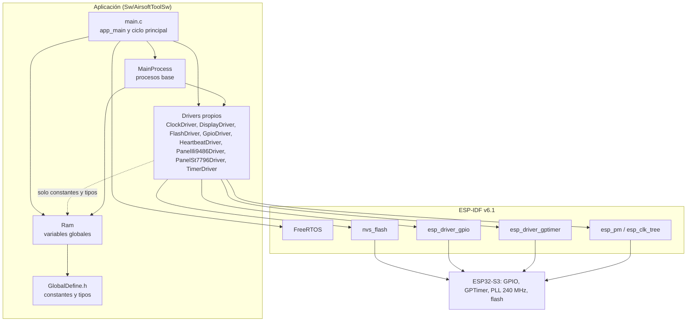
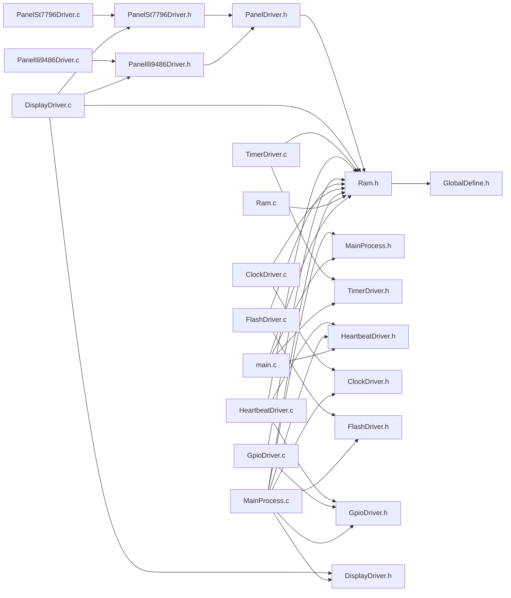
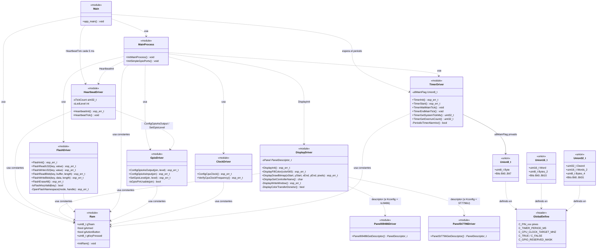
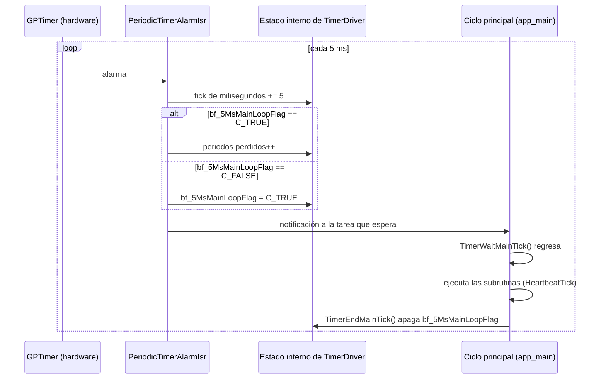
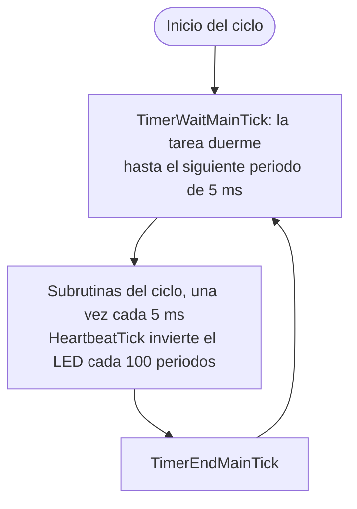

# Sw

Firmware de la herramienta, con ESP-IDF v6.1 para el ESP32-S3-DevKitC-1 N16R8.

Documentación: [`GuiaDesarrollo.md`](GuiaDesarrollo.md) (reglas y flujo de trabajo, empezar por ahí), [`ReferenciaApi.md`](ReferenciaApi.md) (funciones de cada driver), [`MapaPines.md`](MapaPines.md) (pines contra hardware), [`Arquitectura.md`](Arquitectura.md) (diseño objetivo), [`MemoryUsage.md`](MemoryUsage.md) y [`Warnings.md`](Warnings.md) (seguimiento).

Estado actual: proyecto base. Al arrancar inicializa la RAM, fija el reloj del CPU a 240 MHz con el `ClockDriver`, configura los puertos simples e inicia un timer de 5 ms que gobierna el ciclo principal. La única subrutina del ciclo es el heartbeat (LED en GPIO43, ciclo de 1 s); las demás todavía no existen y su espacio está marcado en `main.c`. La consola va por el puerto USB (USB-Serial-JTAG), no por el UART. El pinout de `GlobalDefine.h` es el de v0.7 y el hardware ya es v0.8 o posterior; las diferencias están en [`MapaPines.md`](MapaPines.md). No se ha flasheado en la placa: solo se comprobó que compila.

## Arquitectura

El firmware se organiza en capas. Cada capa solo usa a la de abajo. El diseño objetivo (reglas de encapsulamiento, catálogo de drivers, tareas y núcleos, memoria y plan de PRs) está en [`Arquitectura.md`](Arquitectura.md); esta sección y las siguientes describen el código **actual**.



Los drivers incluyen `Ram.h` solo para obtener constantes y tipos (flecha punteada); no leen ni escriben sus variables, y el compilador lo hace cumplir. El estado interno del `TimerDriver` (bandera, contadores) es privado del driver. Los pendientes frente al diseño objetivo están en [`Arquitectura.md`](Arquitectura.md#10-estado-actual-frente-al-objetivo).

Reglas de la arquitectura:
- Las constantes (`C_*`), los tipos y las uniones viven solo en `GlobalDefine.h`.
- Ningún archivo incluye `GlobalDefine.h` directamente: se incluye solo desde `Ram.h`, y el resto de los archivos incluye `Ram.h` para obtener las constantes y los tipos (R8 de [`Arquitectura.md`](Arquitectura.md)).
- Las variables globales de `Ram.h` solo se declaran si el archivo define `C_RAM_EXPOSE_GLOBALS` antes de incluirlo. Lo definen `main.c` y `Ram.c`. Un driver que no lo define y usa una variable global no compila (R1).
- Las variables globales y los alias de bit (`bf_*`) viven en `Ram.c` / `Ram.h`.
- Cada periférico tiene su driver `[nombre]Driver.c` / `.h`. Un driver valida sus argumentos y devuelve `esp_err_t`; no decide qué hacer ante un error.
- `MainProcess` agrupa el arranque del micro (reloj y puertos). Quien llama a un driver decide si un error es fatal (`ESP_ERROR_CHECK`).

## Estructura de archivos

El código vive en `AirsoftToolSw/` (declarado como componente en `CMakeLists.txt` con `EXTRA_COMPONENT_DIRS`, en lugar de la carpeta `main` por defecto).

| Archivo | Contenido |
| --- | --- |
| `main.c` | `app_main`: inicializa, arranca el timer y ejecuta el ciclo principal. |
| `GlobalDefine.h` | Constantes `C_*` (pines de [`../Hw/esquematico_v1/README.md`](../Hw/esquematico_v1/README.md), tiempos, conversiones, `C_TRUE` / `C_FALSE`) y las uniones `Union8_t`, `Union16_t`, `Union32_t`. |
| `Ram.c` / `Ram.h` | Modelo de la aplicación (`gTeam`, `gArmed`, `gActionButton`, `gKeyPressed`) e `InitRam`. |
| `MainProcess.c` / `.h` | Secuencia de arranque: `InitMainProcess` (reloj, puertos simples, almacenamiento en flash y timer) e `InitSimpleGpioPorts`. |
| `ClockDriver.c` / `.h` | Reloj del CPU: `ConfigCpuClock` (240 MHz por PLL con `esp_pm`) y `VerifyCpuClockFrequency`. |
| `GpioDriver.c` / `.h` | `ConfigGpioAsOutput`, `ConfigGpioAsInput` y `SetGpioLevel`, con validación de pin. |
| `DisplayDriver.c` / `.h` | Pantalla TFT sobre el bus i80 de `esp_lcd` (16 bits). API independiente del controlador: `DisplayInit`, `DisplayFillColor`, `DisplayDrawBitmap`, `DisplayGetControllerName`. El controlador (ILI9486 o ST7796U) se elige en `menuconfig` > Airsoft Tool (`AIRSOFT_LCD_CONTROLLER`). Transferencias bloqueantes; no se llama desde el ciclo de 5 ms. **Sin validar en hardware.** |
| `PanelDriver.h` | Tipos comunes de la capa de panel: `PanelInitCommand_t` y `PanelDescriptor_t` (secuencia de inicio, MADCTL, reloj máximo). |
| `PanelIli9486Driver.c` / `.h` | Descriptor del ILI9486: `PanelIli9486GetDescriptor`. Solo datos, no toca el hardware. Valores de la comunidad, sin validar. |
| `PanelSt7796Driver.c` / `.h` | Descriptor del ST7796U: `PanelSt7796GetDescriptor`. Solo datos, no toca el hardware. Valores del ST7796 de la comunidad, sin confirmar para la variante U. |
| `Kconfig.projbuild` | Opción `AIRSOFT_LCD_CONTROLLER` (ILI9486 por omisión, o ST7796U). |
| `HeartbeatDriver.c` / `.h` | LED de heartbeat en `C_PIN_LED_ESTADO` (GPIO43): `HeartbeatInit` y `HeartbeatTick`. Se llama una vez por periodo de 5 ms y el LED cambia cada `C_HEARTBEAT_HALF_TICKS` (100 periodos = 0.5 s), así que el ciclo completo dura `C_HEARTBEAT_PERIOD_MS` (1 s). Si el ciclo principal se atasca, el LED se queda fijo. No escribe en el log. |
| `FlashDriver.c` / `.h` | Almacenamiento persistente en flash (NVS) bajo el espacio de nombres `C_FLASH_NAMESPACE`: `FlashInit`, `FlashReadU32` / `FlashWriteU32`, `FlashReadBlob` / `FlashWriteBlob` y `FlashEraseAll`. Las escrituras son bloqueantes (decenas de ms): no se llaman dentro de las subrutinas del ciclo de 5 ms. |
| `partitions.csv` | Tabla de particiones propia (ver Configuración). |
| `GuiaDesarrollo.md` | Guía para mantener el firmware: reglas de código, cómo agregar un driver, flujo de Git y qué documentación actualizar. |
| `ReferenciaApi.md` | Funciones públicas de cada driver, con su contexto de uso y sus códigos de error. |
| `MapaPines.md` | Pines del hardware contra las constantes `C_PIN_*`, con las diferencias abiertas. |
| `TimerDriver.c` / `.h` | Timer periódico de 5 ms (GPTimer): `TimerInit`, `TimerStart`, `TimerWaitMainTick`, `TimerEndMainTick`, `TimerGetSystemTickMs` y `TimerGetOverrunCount`. La bandera `u8MainFlag` (bit `bf_5MsMainLoopFlag`), los contadores, la notificación y la ISR son privados del driver. |

Para agregar un driver nuevo: crear `[nombre]Driver.c` / `.h` y sumarlo a `SRCS` en `AirsoftToolSw/CMakeLists.txt` (y su componente de ESP-IDF a `PRIV_REQUIRES`).

## Relación entre archivos

Cada flecha es un `#include` de un archivo propio.



Ningún driver usa variables de `Ram`: `ClockDriver`, `FlashDriver`, `GpioDriver`, `HeartbeatDriver` y `TimerDriver` incluyen `Ram.h` solo para las constantes `C_*` y las uniones. `main.c` y `Ram.c` definen `C_RAM_EXPOSE_GLOBALS` para ver las variables.

## Diagrama de clases UML

Cada archivo `.c` / `.h` se modela como un módulo (clase estática). Los miembros con `-` son privados (`static`).



## Secuencia de arranque

```mermaid
sequenceDiagram
  participant IDF as ESP-IDF
  participant Main as app_main
  participant Ram
  participant MP as MainProcess
  participant Clk as ClockDriver
  participant Gpio as GpioDriver
  participant Fl as FlashDriver
  participant Hb as HeartbeatDriver
  participant Tim as TimerDriver
  IDF->>Main: arranque, CPU a 240 MHz
  Main->>Ram: InitRam()
  Main->>MP: InitMainProcess()
  MP->>MP: imprime chip, flash y PSRAM
  MP->>Clk: ConfigCpuClock()
  Note over Clk: esp_pm_configure fija 240 MHz y<br/>VerifyCpuClockFrequency lo comprueba
  Clk-->>MP: esp_err_t
  MP->>Gpio: InitSimpleGpioPorts(): ConfigGpioAsOutput / ConfigGpioAsInput
  Gpio-->>MP: esp_err_t
  MP->>Fl: FlashInit()
  Note over Fl: nvs_flash_init; si la particion esta llena<br/>o es de otra version, la borra y la crea
  Fl-->>MP: esp_err_t (si falla solo se avisa)
  MP->>Hb: HeartbeatInit()
  Note over Hb: configura GPIO43 como salida, LED apagado
  Hb-->>MP: esp_err_t (si falla solo se avisa)
  MP->>Tim: TimerInit()
  MP->>Tim: TimerStart()
  Tim-->>MP: esp_err_t
  Note over Main: entra al ciclo principal
```

## Interrupción de 5 ms y ciclo principal



Flujo del ciclo principal:



Si las subrutinas tardan más de 5 ms, la siguiente interrupción encuentra la bandera todavía en `C_TRUE`: no la vuelve a escribir y suma un periodo perdido, que se consulta con `TimerGetOverrunCount()`. Ese contador mide si el trabajo del ciclo cabe en el periodo. `TimerGetSystemTickMs()` devuelve los milisegundos desde el arranque del timer.

La bandera es un bit de un byte, y modificarlo es una lectura-modificación-escritura que no es atómica. Por eso cada bit lo escribe un solo contexto a la vez: la ISR lo enciende solo cuando está apagado y `TimerEndMainTick()` lo apaga solo cuando está encendido. Todo esto es interno del driver; el ciclo principal solo llama a `TimerWaitMainTick()` y `TimerEndMainTick()`.

## Configuración

`sdkconfig.defaults` fija:
- target `esp32s3`, flash de 16 MB y PSRAM octal de 8 MB a 80 MHz;
- CPU a 240 MHz (PLL sobre el cristal de 40 MHz; el oscilador interno RC_FAST de unos 17.5 MHz no se usa como fuente del CPU);
- `CONFIG_PM_ENABLE`, necesario para `esp_pm_configure` en `ConfigCpuClock`;
- la tabla de particiones propia `partitions.csv` (`CONFIG_PARTITION_TABLE_CUSTOM`);
- `CONFIG_GPTIMER_ISR_IRAM_SAFE`: la ISR del timer de 5 ms sigue viva mientras se escribe o borra la flash;
- consola por el USB-Serial-JTAG (`CONFIG_ESP_CONSOLE_USB_SERIAL_JTAG`) y log de la ROM apagado (`CONFIG_BOOT_ROM_LOG_ALWAYS_OFF`): así GPIO43 (TX del UART0) queda libre para el LED de heartbeat y no parpadea con los mensajes. Los logs se ven por el puerto USB de la tarjeta, no por el puerto UART.

### Tabla de particiones

La flash es de 16 MB. `Sw/partitions.csv` asigna 10.1 MB y deja 5.9 MB de reserva:

| Partición | Offset | Tamaño | Uso |
| --- | --- | --- | --- |
| `nvs` | `0x9000` | 24 KB | Datos de `FlashDriver` |
| `otadata` | `0xF000` | 8 KB | Control de actualización OTA |
| `phy_init` | `0x11000` | 4 KB | Calibración de radio |
| `ota_0` | `0x20000` | 3 MB | Firmware (`idf.py flash` escribe aquí) |
| `ota_1` | `0x320000` | 3 MB | Segundo slot para actualización OTA |
| `storage` | `0x620000` | 4 MB | Sonidos y recursos gráficos (sin uso todavía) |

No hay partición `factory`: el arranque usa `ota_0`. Cambiar la tabla exige reflashear todo el chip.
El `sdkconfig` generado no se versiona. Los archivos generados del firmware (`build/`, `sdkconfig`, `sdkconfig.old`, `managed_components/`, `dependencies.lock`, `.cache/` y `.clangd`) están en `Sw/.gitignore`; la configuración local de editor, Python, KiCad, Excel y el sistema operativo está en el `.gitignore` de la raíz.

## Reglas de formato del código

- Llave de apertura en la línea de abajo, indentación de 2 espacios y cuerpo un nivel adentro.
- Cada archivo lleva un header (descripción, fecha, micro, compilador, IDE, ADE y licencia) y cada función un header con entradas y salidas.
- Nombres de funciones descriptivos.
- Constantes solo en `GlobalDefine.h`, con formato `C_[NOMBRE]`. Los archivos incluyen `Ram.h`, no `GlobalDefine.h`; `GlobalDefine.h` solo se incluye desde `Ram.h`. El interruptor `C_RAM_EXPOSE_GLOBALS` se define en cada `.c` que necesita las variables globales (no va en `GlobalDefine.h`, porque entonces lo verían todos).
- Uniones con nombre `[tamaño][Nombre]` (por ejemplo `u8MainFlag`, privada de `TimerDriver`) y bits con alias `bf_[nombre descriptivo]`, definido junto a la instancia.
- Condiciones con comparación explícita (`if(x == C_TRUE)`) y paréntesis pegados a la condicional. Los ciclos infinitos se escriben `while(C_TRUE)`.
- Los inputs no usan pull-ups internos: si hacen falta, van en el esquemático.

## Compilar

Desde una terminal con ESP-IDF activado (terminal de la extensión de VS Code, o PowerShell con `C:\Espressif\tools\Microsoft.v6.1.PowerShell_profile.ps1`), dentro de `Sw`:

```
idf.py set-target esp32s3
idf.py build
idf.py -p COMx flash monitor
```

Usar el puerto USB marcado como **UART** de la placa. Si el perfil de PowerShell falla con "MSys/Mingw is no longer supported", vaciar la variable con `$env:MSYSTEM = $null` antes de activarlo (aparece cuando la terminal se abre desde Git Bash).

Antes de cada commit se compila, se actualizan [`Warnings.md`](Warnings.md) (warnings de compilación) y [`MemoryUsage.md`](MemoryUsage.md) (uso de ROM y RAM).
